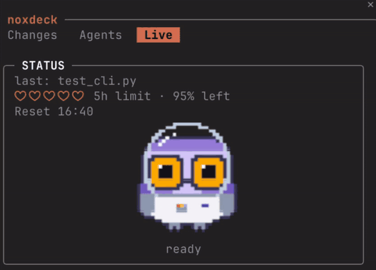
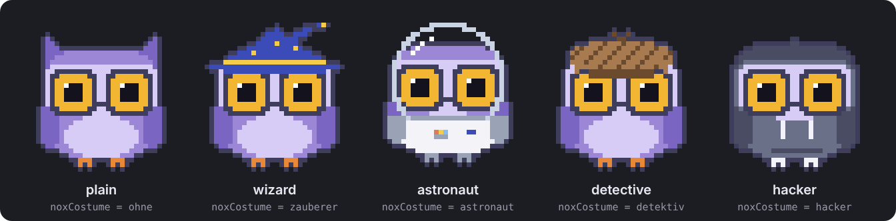
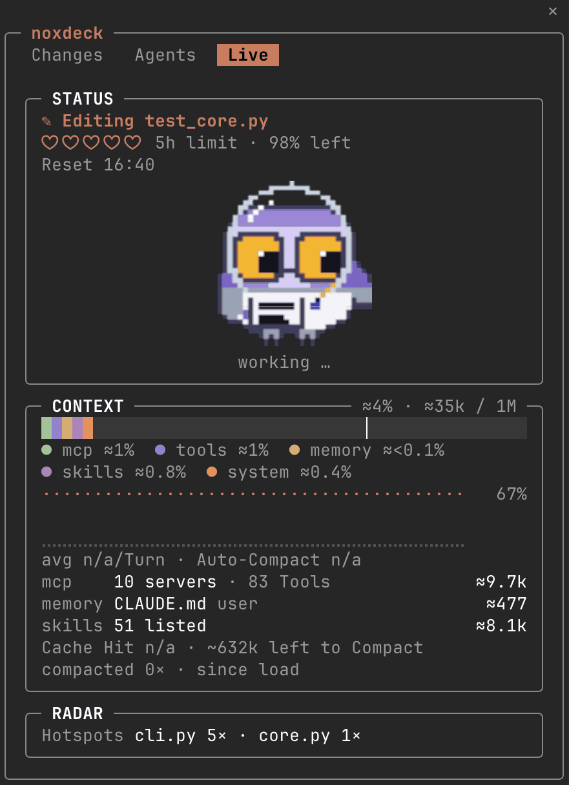
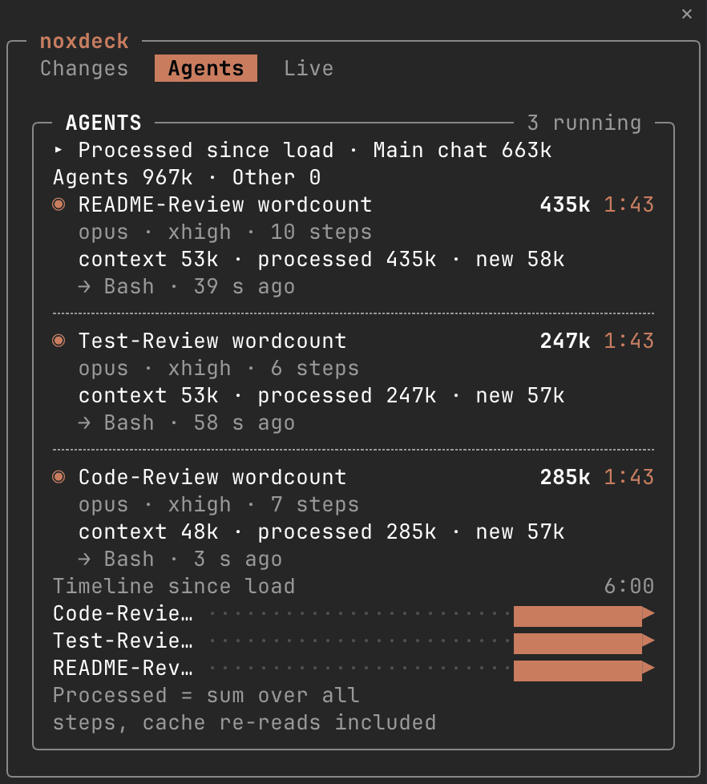
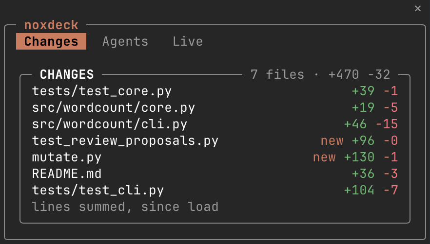

# noxdeck

[English](README.md) · **Deutsch**

[](https://ko-fi.com/noxdeck)



Ein Mod für Claude Code: ein Retro-Terminal-Dashboard in einem Pane neben dem Transkript, mit Nox, einer kleinen Pixel-Eule, die zeigt, was Claude gerade tut. Er beobachtet nur.



## Screenshots

<table>
  <tr>
    <td valign="top"><br>Live</td>
    <td valign="top"><br>Agents</td>
    <td valign="top"><br>Changes</td>
  </tr>
</table>

## Was er zeigt

- **Live** (der Standard-Tab):
  - **STATUS**: die Datei, die Claude gerade bearbeitet, das Nutzungslimit als fünf Herzen oder als Balken aus zehn Zellen mit dem Zeitpunkt, zu dem es zurückgesetzt wird, und Nox mit einer Zeile darunter (arbeitet, bereit, braucht deine Freigabe, fragt dich, Fehler, fertig, Agents bei der Arbeit). Das Limit ist das 5-Stunden-Limit (`5h-Limit · 70 % übrig`, Reset als Uhrzeit); wo das Konto keins hat, etwa bei Ultra, das Wochenlimit für alle Modelle (`Woche · 83 % übrig`, Reset als Wochentag und Uhrzeit). Ohne beide, etwa ohne Abo, fehlt die Zeile.
  - **CONTEXT**: wie voll das Kontextfenster ist, nach Quelle (Nachrichten, MCP, Tools, Memory, Skills, System), ein Verlauf, das Wachstum pro Turn, die Cache-Trefferquote und wie viel bis zur automatischen Kompaktierung bleibt. Die Kopfzeile endet mit der Zahl der Kompaktierungen der Unterhaltung (`0× komp.`). Gezählt wird pro Unterhaltung: Eine fortgesetzte (`--continue`, `/resume`) zählt weiter, eine neue und `/clear` beginnen bei 0. Kompaktierungen im Leerlauf zählen mit; solche aus der Zeit vor der Installation von noxdeck fehlen.
  - **RADAR**: derselbe Aufruf, der wieder und wieder scheitert, die Fehler seit dem Laden, die am häufigsten gelesenen oder bearbeiteten Dateien (Hotspots) und wie lange Freigabedialoge auf dich gewartet haben. Solange die Sitzung ein Todo-Tool hat, steht an seiner Stelle **PLAN** mit Claudes Todo-Liste.
- **Changes**: die in dieser Sitzung geänderten Dateien mit hinzugefügten und entfernten Zeilen, jede mit ihrem Pfad ab dem Projektordner. Cache- und Build-Dateien, die ein Bash-Befehl nebenbei erzeugt (in `__pycache__`, `.pytest_cache`, `.mypy_cache`, `.ruff_cache`, `node_modules`, `.venv` oder `.git`, `*.pyc`, `*.pyo`, `.DS_Store`), werden unter der Liste gezählt, nicht aufgeführt; ein Edit oder Write dort steht immer in der Liste.
- **Agents**: was Haupt-Chat, Subagents und andere Schleifen seit dem Laden verarbeitet haben, Modell, Tokens und aktuelle Tätigkeit jedes Subagents, in Gruppen, die sich zuklappen lassen, und eine Zeitleiste. Die Agents eines Workflows stehen unter ihrem Lauf, eine Zeile je Lauf mit Name, Agents, Tokens und Dauer; laufende Agents zeigen sich immer einzeln mit ihrer Tätigkeit; ältere Läufe, die nicht mehr passen, fasst eine Zeile zusammen. Ein aufgeklappter Lauf zeigt seine Agents in der Reihenfolge, in der sein Skript sie gestartet hat, und zählt, was keine Zeile findet (`+38 weitere`); ist das Pane niedrig und etwa 100 Spalten breit, stehen die fertigen Läufe in zwei Spalten, eine nach der anderen gefüllt, ein aufgeklappter Lauf ganz in einer. Der Kopf zählt jeden Agent seit dem Laden. Ein Druck auf die Zeile eines Agents zeigt sein Transkript in der Hauptansicht.

Nox ist ein Pixelbild, wo das Terminal Bilder zeichnet (Ghostty, kitty; iTerm2 ab 3.5 mit Vollbild-Rendering; tmux mit eingeschaltetem `allow-passthrough` und `focus-events`), und überall sonst aus Blockzeichen. Nox liest, schreibt, arbeitet in der Shell, denkt nach, winkt, wenn ein Subagent startet, wartet auf dich, freut sich, wenn der Turn fertig ist, erschrickt bei einem Fehler, warnt vor einer Schleife, schwitzt, wenn der Kontext voll wird, wird müde, wenn das Limit, das STATUS zeigt, knapp wird (unter 20 % übrig), und gähnt und schläft nach zwei Minuten ohne Turn. Wo das Pane niedrig ist, nimmt eine Mini-Eule seinen Platz ein.

**In Team- und Enterprise-Plänen oder wenn eine Organisation die Einstellungen von Claude Code verwaltet,** zeigt noxdeck seit 1.1.2 dasselbe wie überall sonst. In jedem Plan gilt: Nach einer Kompaktierung steigt der Zähler erst mit deiner nächsten Eingabe, nicht sofort.

## Installation

Dieses Repository ist sein eigener Plugin-Marketplace: [`.claude-plugin/marketplace.json`](.claude-plugin/marketplace.json) nennt ein Plugin, `noxdeck`, aus dem Wurzelordner des Repositorys.

In Claude Code:

```
/plugin marketplace add LVStiller/noxdeck
/plugin install noxdeck@noxdeck
```

Oder in einer Shell in einem Schritt: `claude plugin install noxdeck --marketplace LVStiller/noxdeck`. Das fügt zuerst den Marketplace `noxdeck` hinzu, falls er noch fehlt.

Aktualisieren: `claude plugin marketplace update noxdeck`, `claude plugin update noxdeck@noxdeck`, dann `/reload-plugins` in einer laufenden Sitzung.

## Benutzung

- Das Pane öffnet sich von selbst in Terminals ab 144 Spalten Breite (das Vollbild-Layout dockt es neben dem Transkript an).
- `/noxdeck` öffnet es bei jeder Breite; `/noxdeck live`, `/noxdeck changes` und `/noxdeck agents` öffnen es auf diesem Tab.
- Einen Tab anklicken, oder das Pane fokussieren (ctrl+x tab) und Tab und Enter benutzen.
- Inline über dem Prompt (im Vollbild-Layout unter 110 Spalten, auf dem Main-Screen immer, etwa in tmux) nimmt das Pane wenig Höhe: Titel und Tabs in einer Zeile, ab 80 Spalten STATUS und CONTEXT nebeneinander, im Vollbild-Layout mit der Mini-Eule, wo das Terminal Bilder zeichnet, und RADAR oder PLAN als eine Zeile; schmaler Status, Limit, Kontext-Balken und eine RADAR-Zeile. Was keinen Platz findet, wird gezählt, nie still abgeschnitten.

## Getestet mit

Claude Code 2.1.327. Die Mod-API ist Early Access und kann sich zwischen Releases ändern.

## Einstellungen

In `/config`, jeweils unter `noxdeck.<name>`, oder bei der Installation in einer Shell mit `--config <name>=<wert>` (zum Beispiel `claude plugin install noxdeck@noxdeck --config language=de`, sobald der Marketplace hinzugefügt ist).

| Einstellung | Werte | Was sie tut |
| --- | --- | --- |
| `language` | `en` (Standard), `de` | Sprache der Sätze und Zustände im Pane. Tab-Namen, Kartentitel und eingeführte Begriffe (Context, Tokens, MCP, Cache Hit, Auto-Compact, Hotspots, …) bleiben Englisch. |
| `noxStyle` | `fein` (Standard), `klassisch` | Der Stil: `fein` zeichnet Nox als Pixelbild, wo das Terminal es kann, sonst aus Blockzeichen; `klassisch` zeichnet immer die Blockzeichen. |
| `noxPalette` | `standard` (Standard), `nacht`, `retro` | Die Palette des Pixel-Nox: Lavendel, Blau und Silber oder Grüntöne. |
| `noxCostume` | `ohne` (Standard), `zauberer`, `astronaut`, `detektiv`, `hacker`, `zufall` | Das Kostüm des Pixel-Nox: keins, Zauberer, Astronaut, Detektiv oder Hacker. `zufall` zieht zu Beginn jeder Sitzung eines der vier und behält es bis zum Ende der Sitzung, auch über ein Neuladen hinweg. Der Block-Nox trägt keins. |
| `animations` | `voll` (Standard), `ruhig`, `aus` | Wie viel Nox sich bewegt: jede Animation, nur Blinzeln und der Wechsel des Zustands, oder ein Standbild. Die Claude-Code-Einstellung Reduce motion hält `voll` auf `ruhig`. |
| `limitStyle` | `hearts` (Standard), `bar` | Wie STATUS das Nutzungslimit zeichnet, das es zeigt (das 5-Stunden-Limit, sonst das Wochenlimit für alle Modelle): fünf Herzen oder ein Balken aus zehn Zellen. |
| `theme` | `classic` (Standard) | Das Farbschema des Panes; es zeichnet in den Farben deines Claude-Code-Themes. |

## Was dieser Mod kann

`claude plugin validate .` liest das Hooks-Modul so, wie Claude Code es lädt, und nennt jedes Ereignis, in das es sich einhängt, und jeden Aufruf, den es auf `$` macht. Für noxdeck 1.1.2:

```
hooks: session.start, command.run{command=noxdeck}, ui.close{id=noxdeck}, tool.call, agent.spawn, tool.check, tool.judge, tool.run, turn.step, turn.start, turn.complete, session.measure, session.end, ui.render{component=Pane, requestId=noxdeck} (default matcher key: plugin), ui.render{component=SessionMode}
calls: $.agent.list, $.clock.after, $.clock.every (via ensureTicker), $.clock.now, $.command.register, $.session.id (via restoreCount), $.session.root (via refreshRoot), $.session.usage (via lookForCompaction, refreshContext), $.settings.read (via readMotion), $.state.get, $.state.set, $.store.delete (via tidyCounts), $.store.get (via restoreCount, tidyCounts), $.store.keys (via tidyCounts), $.store.set (via countCompaction, restoreCount), $.tool.list (via refreshTodoTools), $.ui.blit (via blit), $.ui.open (via openPane), $.ui.panes (via isPaneOpen, isPaneShown), $.ui.resolve, $.ui.toast, $.ui.view (via showView)
```

Jeder Hook außer dem, der `/noxdeck` beantwortet, und den beiden, die zeichnen, gibt sein Ereignis unverändert weiter und liefert zurück, was Claude Code geantwortet hat (siehe [Hooks im Einzelnen](#hooks-im-einzelnen)). Die Aufrufe lesen (Tools, Kontextverbrauch, den Projektordner, Agents, Panes, die Einstellung Reduce motion), registrieren `/noxdeck`, betreiben seinen Timer, zeichnen sein eigenes Pane, halten seine Zahlen in seinem eigenen `$.state` und den Kompaktierungszähler jeder Unterhaltung in seinem eigenen `$.store`. Ein Aufruf handelt, und nur, wenn du auf die Zeile eines Agents drückst: `$.ui.view` zeigt das Transkript dieses Agents in der Hauptansicht; eine Ablehnung (oder, bei einem Agent eines Workflows, wo er zu sehen ist) erscheint mit `$.ui.toast`.

Kein Netzwerk, kein Prompt-Logging, ein kleiner Eintrag auf der Platte: noxdeck stellt keine Netzwerkanfragen, startet keine Prozesse, ruft kein Modell auf, behält keinen Prompt-Text und liest kein Transkript eines Agents. Über die Sitzung hinaus behält es nur, wie oft jede Unterhaltung kompaktiert wurde, im Plugin-Store, den Claude Code für es unter `plugins/store/` in deinem Claude-Code-Konfigurationsordner führt (standardmäßig `~/.claude/plugins/store/`): ein Kürzel der Session-ID, den Zählerstand und einen Zeitstempel, 30 Tage lang und für höchstens 50 Unterhaltungen. Nichts davon verlässt deinen Rechner (siehe [PRIVACY.md](PRIVACY.md)). Eine andere Datei schreibt es nicht. Geheimnisse in Befehlen, die es zeigt (Tokens, Schlüssel, Passwörter), werden maskiert. Nox' Bilder entstehen im Speicher.

### Hooks im Einzelnen

| Hook | Was er beobachtet | Entscheidet oder ändert er etwas? |
| --- | --- | --- |
| `session.start` | Den Start der Sitzung: Er liest die Einstellung Reduce motion, den Projektordner, das Kontextfenster und die Agent-Liste, übernimmt den Kompaktierungszähler der Unterhaltung aus seinem Store, registriert `/noxdeck` und öffnet sein Pane (in einer interaktiven Sitzung, außer du hast es geschlossen). | Nein: Das Ereignis geht unverändert weiter. |
| `command.run{command=noxdeck}` | Nur `/noxdeck`; kein anderer Befehl erreicht ihn. | Beantwortet `/noxdeck` selbst: öffnet das Pane (auf dem genannten Tab) und antwortet mit einer Zeile. |
| `ui.close{id=noxdeck}` | Das Schließen seines eigenen Panes. | Nein; er merkt sich, dass du es geschlossen hast, damit das Pane nicht von selbst wieder aufgeht. |
| `tool.call` | Jeden Tool-Aufruf und sein Ergebnis: das Tool, den Namen einer Datei, die Zeilen, die eine Änderung hinzugefügt und entfernt hat, ob er fehlgeschlagen ist, Claudes Todo-Liste, Name und Kennung eines Workflow-Laufs. | Nein: Aufruf und Ergebnis gehen unverändert weiter. |
| `agent.spawn` | Den Start eines Subagents: seine Beschreibung, seinen Typ, ob ein Workflow ihn gestartet hat und in welchem Lauf (seinen Prompt nur als Hash und Länge, um seinen ersten Turn daran zu erkennen). | Nein: `return next(e)`, die Antwort ungelesen. |
| `tool.check` | Die Freigabeprüfung eines Aufrufs und ihr Urteil: Bei `ask` öffnet sich gleich ein Dialog, also zeigt Nox ein ? und die Wartezeit auf deine Antwort beginnt. | Nein: Das Urteil wird gelesen und unverändert zurückgegeben. |
| `tool.judge` | Dass der Klassifikator des Auto-Modus zu einem Aufruf gefragt wird: kein Dialog für dich, also kein ? und keine gezählte Freigabe. | Nein: `return next(e)`, die Antwort ungelesen. |
| `tool.run` | Dass ein erlaubter Aufruf zu laufen beginnt: Sein Dialog, falls es einen gab, endet hier, und mit ihm die Wartezeit. | Nein: Aufruf und Antwort gehen unverändert durch. |
| `turn.step` | Die Tokens jeder Modellanfrage, sobald ihre Antwort vollständig ist; zu Beginn einer Anfrage des Haupt-Chats, ob das Kontextfenster noch einen Füllstand hat, um eine Kompaktierung zu zählen. | Nein: Jeder Chunk und das Ergebnis gehen durch, wie sie kamen; Modell und Effort werden nie umgeschrieben. |
| `turn.start` | Den Start eines Turns, des Haupt-Chats oder eines Subagents; beim Start im Haupt-Chat, ob das Kontextfenster noch einen Füllstand hat, um eine Kompaktierung zu zählen. | Nein: Das Ereignis geht unverändert weiter. |
| `turn.complete` | Das Ende eines Turns: warum, wie lange, seine Tokens. | Nein: Das Ereignis geht unverändert weiter. |
| `session.measure` | Änderungen am Kontextverbrauch und an den Nutzungslimits (5 Stunden, Woche). | Nein: Das Ereignis geht unverändert weiter. |
| `session.end` | `/clear` oder `/resume`, nach denen das Pane neu beginnt, mit dem Kompaktierungszähler der Unterhaltung, die folgt. | Nein: Das Ereignis geht unverändert weiter. |
| `ui.render{component=Pane, requestId=noxdeck}` | – | Zeichnet noxdecks eigenes Pane. |
| `ui.render{component=SessionMode}` | – | Ergänzt die Fußzeile um `noxdeck · <Theme>`, hinter dem, was Claude Code dort zeichnet. |

Kein Hook entscheidet, ob ein Tool laufen darf, beantwortet eine Berechtigungsfrage oder ändert einen Prompt, eine Einstellung oder das Ereignis eines anderen Plugins.

### Was der Mod wohin sendet

noxdeck stellt keine Netzwerkanfragen. Was das Modul verlässt, geht an Claude Code auf diesem Rechner, über diese Aufrufe auf `$`. Jeder gehört zu Claude Codes eigener Mod-API; keiner stammt aus einem anderen Plugin, und noxdeck braucht kein anderes Plugin. Das gilt auch für `$.ui.view`, das das Plugin-Verzeichnis unter „Not recognized“ führt: Claude Codes eigene Typen deklarieren es (`$.ui.view({ agentId })` und das Ereignis `ui.view`).

| Aufruf | Was er tut |
| --- | --- |
| `$.ui.blit` | Schickt Nox' Bilder (im Speicher erzeugte Pixel) ans Terminal, in noxdecks eigenes Pane; ein unsichtbares Testbild sagt zuerst, ob das Terminal Bilder zeichnet. |
| `$.ui.view` | Öffnet das Transkript eines Agents (oder wieder den Haupt-Chat) in der Hauptansicht, nur wenn du auf seine Zeile drückst. |
| `$.ui.toast` | Zeigt einen kurzen Hinweis: warum eine Ansicht abgelehnt wurde, oder dass man den Agent eines Workflows über `/workflows` sieht. |
| `$.settings.read` | Liest nur eine Einstellung, Reduce motion (`prefersReducedMotion`), damit Nox sich weniger bewegt, wenn du das in Claude Code eingestellt hast. |
| `$.ui.open`, `$.ui.panes`, `$.ui.resolve` | Öffnen noxdecks Pane, fragen, ob es offen und sichtbar ist, und holen die Elemente, mit denen es zeichnet. |
| `$.command.register` | Registriert `/noxdeck`. |
| `$.agent.list`, `$.tool.list`, `$.session.root`, `$.session.usage` | Lesen die Agents, die Tools des Modells (für die PLAN-Karte), den Projektordner (Pfade werden ab ihm gezeigt) und den Kontextverbrauch. |
| `$.state.get`, `$.state.set` | Halten die Zahlen des Panes für die Sitzung in noxdecks eigenem State; nichts wird auf die Platte geschrieben. |
| `$.session.id` | Liest die ID der Sitzung, nur um sie zu hashen: Der Kompaktierungszähler wird pro Unterhaltung geführt. |
| `$.store.get`, `$.store.set`, `$.store.delete`, `$.store.keys` | Halten den Kompaktierungszähler jeder Unterhaltung über die Sitzung hinaus in noxdecks eigenem Store: ein Kürzel der Session-ID (nie die ID selbst), den Zählerstand und einen Zeitstempel. Einträge, die älter als 30 Tage sind, und alle außer den neuesten 50 werden entfernt. |
| `$.clock.now`, `$.clock.every`, `$.clock.after` | Lesen die Zeit und betreiben den Timer des Panes. |

noxdeck hat keinen MCP-Server und reicht keine Umgebungsvariablen weiter. [`hooks/secrets.ts`](hooks/secrets.ts) maskiert nur angezeigten Text: Es ersetzt, was im Text eines Tool-Aufrufs wie ein Token, ein Schlüssel oder ein Passwort aussieht, bevor das Pane ihn behält oder zeigt. Es liest keine Umgebungsvariablen und keine Dateien mit Zugangsdaten, und was es maskiert, wird verworfen.

## Entwickeln

```sh
claude plugin validate .
claude plugin test .
```

Alle Texte des Panes stehen in [`hooks/strings.ts`](hooks/strings.ts), auf Englisch und Deutsch; ein Test schlägt fehl, wenn einer der beiden Sprachen ein Schlüssel fehlt.

[`hooks/sprites.ts`](hooks/sprites.ts) ist rund 105 KB groß, weil es Nox' Bilder als Daten enthält (lauflängenkodierte Pixelzeilen und Paletten), keine Logik, und das einzige `.then` im Code liest beide Ausgänge von `$.ui.view` (die Antwort oder die Ablehnung, die die Absage eines anderen Plugins auslöst); noxdeck definiert keinen Proxy, keinen Getter und keine `then`-Methode, deshalb bleiben beide Stellen, die das Plugin-Verzeichnis zur Prüfung zurückhält, wie sie sind.

## Hinweis

noxdeck steht in keiner Verbindung zu Anthropic. Es ist ein Hobbyprojekt, ohne Gewährleistung und ohne Support-Versprechen. Siehe [LICENSE](LICENSE) (MIT). Sicherheitslücken: siehe [SECURITY.md](SECURITY.md). Datenschutz: siehe [PRIVACY.md](PRIVACY.md).

## Autor

Luis Vincent Stiller, [github.com/LVStiller](https://github.com/LVStiller)

## Support

Für Hilfe, Fragen oder Fehlerberichte eröffne ein Issue: [github.com/LVStiller/noxdeck/issues](https://github.com/LVStiller/noxdeck/issues).

Wenn dir noxdeck nützt, kannst du es auf [Ko-fi](https://ko-fi.com/noxdeck) unterstützen.

[](https://ko-fi.com/noxdeck)
