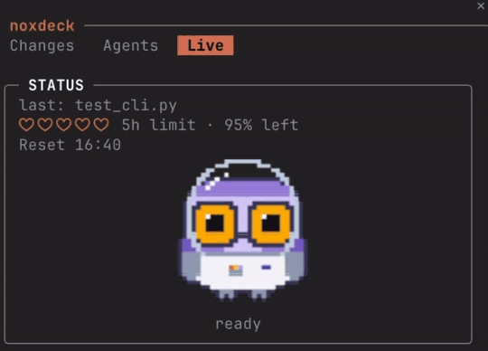
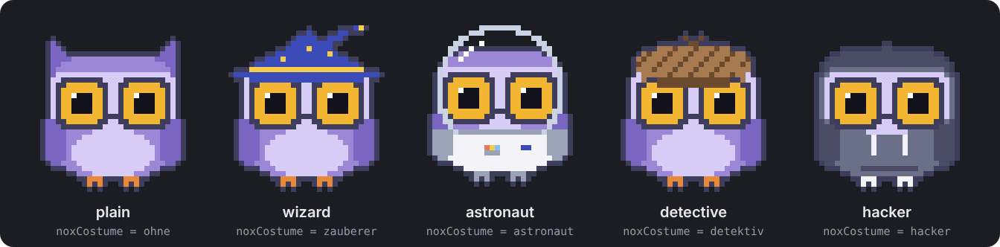
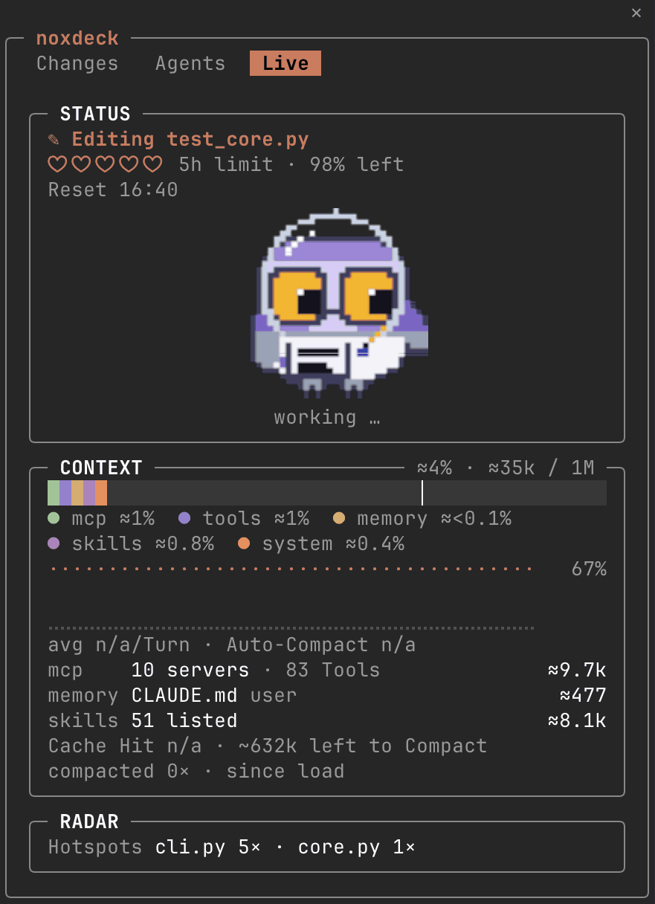
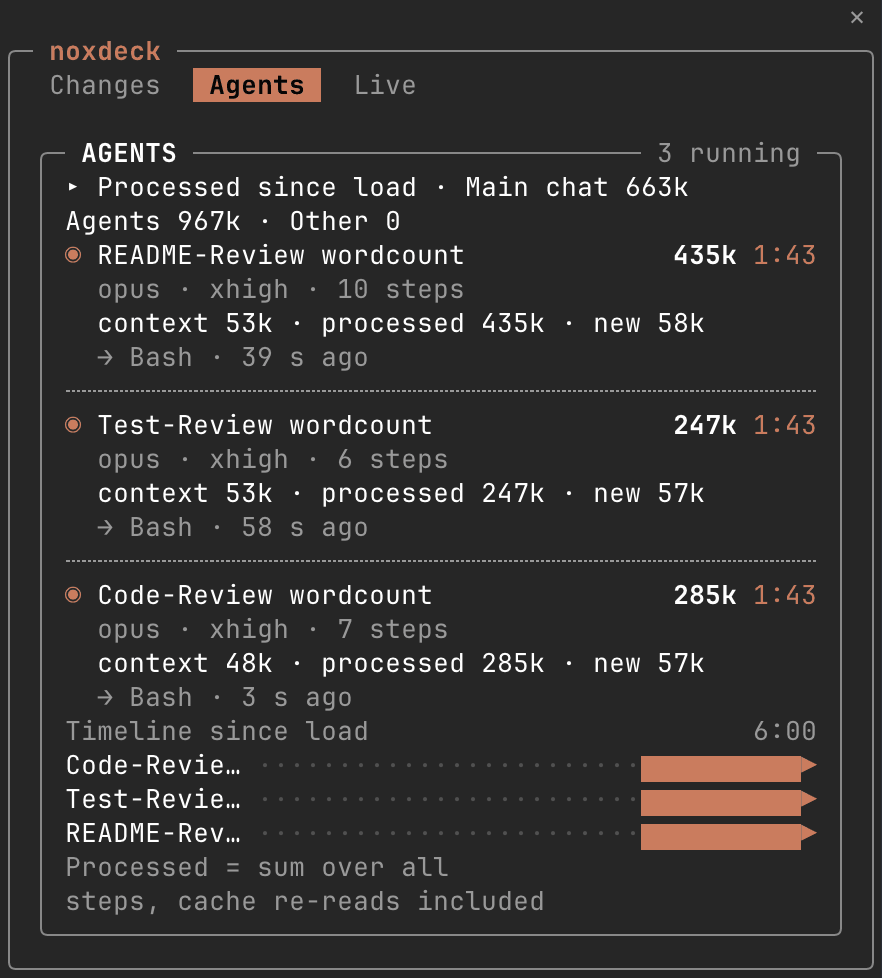
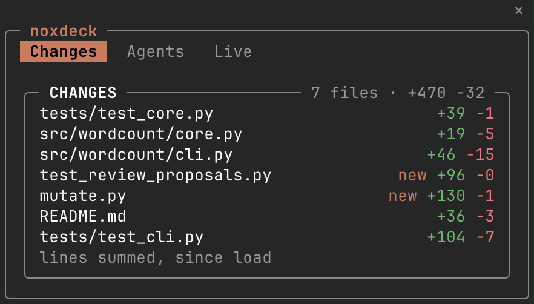

# noxdeck

**English** · [Deutsch](README.de.md)

[](https://ko-fi.com/noxdeck)



A Claude Code mod: a retro terminal dashboard in a pane beside the transcript, with Nox, a small pixel owl that shows what Claude is doing. It only observes.



## Screenshots

<table>
  <tr>
    <td valign="top"><br>Live</td>
    <td valign="top"><br>Agents</td>
    <td valign="top"><br>Changes</td>
  </tr>
</table>

## What it shows

- **Live** (the default tab):
  - **STATUS**: the file Claude is editing, the 5-hour limit as five hearts or a ten-cell bar with the time it resets, and Nox with a caption (working, ready, needs your approval, asking you, error, done, agents at work).
  - **CONTEXT**: how full the context window is, by source (messages, MCP, tools, memory, skills, system), a history, growth per turn, cache hit rate and how much is left until auto-compaction.
  - **RADAR**: the same call failing again and again, failures since load, the files read or edited most (hotspots) and how long approval dialogs waited on you. While the session has a todo tool, **PLAN** shows Claude's todo list in its place.
- **Changes**: the files changed in this session, with lines added and removed, each by its path from the project folder. Cache and build files a Bash command makes on the side (in `__pycache__`, `.pytest_cache`, `.mypy_cache`, `.ruff_cache`, `node_modules`, `.venv` or `.git`, `*.pyc`, `*.pyo`, `.DS_Store`) are counted below the list, not listed; an Edit or Write there is always listed.
- **Agents**: what the main chat, the subagents and other loops processed since load, each subagent's model, tokens and current activity, in groups that fold, and a timeline. A press on an agent's row shows its transcript in the main view.

Nox is a pixel picture where the terminal draws pictures (Ghostty, kitty; iTerm2 3.5 and later in fullscreen rendering; tmux with `allow-passthrough` and `focus-events` on) and block characters everywhere else. It reads, writes, runs the shell, thinks, waves when a subagent starts, waits for you, is glad when the turn is done, startles at a failure, warns of a loop, sweats when the context fills up, gets tired when the 5-hour limit runs low, and yawns and sleeps after two minutes without a turn. Where the pane is short, a mini owl takes its place.

## Installation

This repository is its own plugin marketplace: [`.claude-plugin/marketplace.json`](.claude-plugin/marketplace.json) lists one plugin, `noxdeck`, from the repository root.

In Claude Code:

```
/plugin marketplace add LVStiller/noxdeck
/plugin install noxdeck@noxdeck
```

Or in a shell, in one step: `claude plugin install noxdeck --marketplace LVStiller/noxdeck`. It adds the marketplace `noxdeck` first if it is not added yet.

To update: `claude plugin marketplace update noxdeck`, `claude plugin update noxdeck@noxdeck`, then `/reload-plugins` in a running session.

## Use

- The pane opens by itself on terminals 144 columns or wider (the fullscreen layout docks it beside the transcript).
- `/noxdeck` opens it at any width; `/noxdeck live`, `/noxdeck changes` and `/noxdeck agents` open it on that tab.
- Click a tab, or focus the pane (ctrl+x tab) and use Tab and Enter.

## Tested with

Claude Code 2.1.312. The mod API is early access and may change between releases.

## Settings

In `/config`, each under `noxdeck.<name>`, or when installing in a shell with `--config <name>=<value>` (for example `claude plugin install noxdeck@noxdeck --config language=de`, once the marketplace is added).

| Setting | Values | What it does |
| --- | --- | --- |
| `language` | `en` (default), `de` | Language of the pane's sentences and states. Tab names, card titles and established terms (Context, Tokens, MCP, Cache Hit, Auto-Compact, Hotspots, …) stay English. |
| `noxStyle` | `fein` (default), `klassisch` | The style: `fein` draws Nox as a pixel picture where the terminal can, block characters elsewhere; `klassisch` always draws the block characters. |
| `noxPalette` | `standard` (default), `nacht`, `retro` | The pixel Nox's palette: lavender, blue and silver, or shades of green. |
| `noxCostume` | `ohne` (default), `zauberer`, `astronaut`, `detektiv`, `hacker`, `zufall` | The pixel Nox's costume: none, wizard, astronaut, detective or hacker. `zufall` (random) draws one of the four at each session's start and keeps it until the session ends, a reload included. The block Nox wears none. |
| `animations` | `voll` (default), `ruhig`, `aus` | How much Nox moves: every animation, only blinking and the change of state, or a still picture. Claude Code's Reduce motion setting holds `voll` to `ruhig`. |
| `limitStyle` | `hearts` (default), `bar` | How STATUS draws the 5-hour limit: five hearts or a ten-cell bar. |
| `theme` | `classic` (default) | The pane's color theme; it draws in your Claude Code theme's colors. |

## What this mod can do

`claude plugin validate .` reads the hooks module the way Claude Code loads it and prints every event it hooks and every call it makes on `$`. For noxdeck 1.0.5:

```
hooks: session.start, command.run{command=noxdeck}, ui.close{id=noxdeck}, tool.call, agent.spawn, tool.check, classic.PreToolUse, classic.PermissionRequest, classic.PermissionDenied, classic.PostToolUseFailure, classic.PostToolUse, turn.step, turn.start, turn.complete, session.measure, session.compact, session.end, ui.render{component=Pane, requestId=noxdeck}, ui.render{component=SessionMode}
calls: $.agent.list, $.clock.after, $.clock.every (via ensureTicker), $.clock.now, $.command.register, $.session.root (via refreshRoot), $.session.usage (via refreshContext), $.settings.read (via readMotion), $.state.get, $.state.set, $.tool.list (via refreshTodoTools), $.ui.blit (via blit), $.ui.open (via openPane), $.ui.panes (via isPaneOpen, isPaneShown), $.ui.resolve, $.ui.toast, $.ui.view (via showView)
```

Every hook but the one answering `/noxdeck` and the two that draw passes its event on unchanged and returns what Claude Code answered (see [Hooks in detail](#hooks-in-detail)). The calls read (tools, context usage, the project root, agents, panes, the Reduce motion setting), register `/noxdeck`, run its timer, draw its own pane and keep its figures in its own `$.state`. One call acts, and only when you press an agent's row: `$.ui.view` shows that agent's transcript in the main view; a refusal (or, for a workflow's agent, where to see it) is shown with `$.ui.toast`.

No network, no file writes, no prompt logging: noxdeck makes no network requests, writes no files, starts no processes, calls no model, keeps no prompt text and reads no agent's transcript. Secrets in commands it shows (tokens, keys, passwords) are masked. Nox's pictures are made in memory.

### Hooks in detail

| Hook | What it observes | Decides or changes |
| --- | --- | --- |
| `session.start` | The session starting: it reads the Reduce motion setting, the project folder, the context window and the agent list, registers `/noxdeck` and opens its pane (in an interactive session, unless you closed it). | Nothing: the event passes on unchanged. |
| `command.run{command=noxdeck}` | Only `/noxdeck`; no other command reaches it. | Answers `/noxdeck` itself: opens the pane (on the tab named) and replies with one line. |
| `ui.close{id=noxdeck}` | Its own pane closing. | Nothing; it remembers that you closed it, so the pane does not open by itself again. |
| `tool.call` | Every tool call and its result: the tool, a file's name, the lines a change added and removed, whether it failed, Claude's todo list. | Nothing: the call and its result pass unchanged. |
| `agent.spawn` | A subagent starting: its description and type (its prompt only as a hash, to tell its first turn by). | Nothing: `return next(e)`, the answer unread. |
| `tool.check` | That a call reached the permission check. | Nothing: `return next(e)`, the verdict unread. |
| `classic.PreToolUse` | That a call reached the PreToolUse hooks. | Nothing: `return next(e)`. |
| `classic.PermissionRequest` | A permission dialog opening: Nox shows a ? until the call ends. | Nothing: `return next(e)`, the answer unread. |
| `classic.PermissionDenied` | The auto-mode check refusing a call, so RADAR does not count it as a failure. | Nothing: `return next(e)`. |
| `classic.PostToolUseFailure` | A tool that failed or was interrupted as it ran, and how long it ran. | Nothing: `return next(e)`. |
| `classic.PostToolUse` | A tool that ran, and how long it ran. | Nothing: `return next(e)`. |
| `turn.step` | Each model request's tokens, once its response is whole. | Nothing: every chunk and the result pass through as they came; model and effort are never rewritten. |
| `turn.start` | A turn starting, the main chat's or a subagent's. | Nothing: the event passes on unchanged. |
| `turn.complete` | A turn ending: why, how long, its tokens. | Nothing: the event passes on unchanged. |
| `session.measure` | The context usage and the 5-hour limit changing. | Nothing: the event passes on unchanged. |
| `session.compact` | A compaction, to count it. | Nothing: the event passes on unchanged. |
| `session.end` | `/clear` or `/resume`, after which the pane starts over. | Nothing: the event passes on unchanged. |
| `ui.render{component=Pane, requestId=noxdeck}` | – | Draws noxdeck's own pane. |
| `ui.render{component=SessionMode}` | – | Adds `noxdeck · <theme>` to the footer, after what Claude Code draws there. |

No hook decides whether a tool may run, answers a permission question, or changes a prompt, a setting or another plugin's event.

### What it sends, and where

noxdeck makes no network requests. What leaves the module goes to Claude Code on this machine, through these calls on `$`. Each is Claude Code's own mod API; none comes from another plugin, and noxdeck needs no other plugin.

| Call | What it does |
| --- | --- |
| `$.ui.blit` | Sends Nox's pictures (pixels made in memory) to the terminal, into noxdeck's own pane; an invisible probe picture first tells whether the terminal draws pictures. |
| `$.ui.view` | Opens an agent's transcript (or the main chat again) in the main view, only when you press its row. |
| `$.ui.toast` | Shows a short notice: why a view was refused, or that a workflow's agent is seen with `/workflows`. |
| `$.settings.read` | Reads one setting only, Reduce motion (`prefersReducedMotion`), so Nox moves less when you asked Claude Code for that. |
| `$.ui.open`, `$.ui.panes`, `$.ui.resolve` | Open noxdeck's pane, ask whether it is open and shown, and get the elements it draws with. |
| `$.command.register` | Registers `/noxdeck`. |
| `$.agent.list`, `$.tool.list`, `$.session.root`, `$.session.usage` | Read the agents, the model's tools (for the PLAN card), the project folder (paths are shown from it) and the context usage. |
| `$.state.get`, `$.state.set` | Keep the pane's figures in noxdeck's own state for the session; nothing is written to disk. |
| `$.clock.now`, `$.clock.every`, `$.clock.after` | Read the time and run the pane's timer. |

## Develop

```sh
claude plugin validate .
claude plugin test .
```

All texts of the pane live in [`hooks/strings.ts`](hooks/strings.ts), in English and German; a test fails when either language lacks a key.

[`hooks/sprites.ts`](hooks/sprites.ts) is about 105 KB because it holds Nox's pictures as data (run-length coded pixel rows and palettes), not logic, and the one `.then` in the code reads both outcomes of `$.ui.view` (its answer, or the rejection another plugin's refusal causes); noxdeck defines no Proxy, getter or `then` method, so the plugin directory's review holds for both stay as they are.

## Disclaimer

noxdeck is not affiliated with Anthropic. It is a hobby project, with no warranty and no support promise. See [LICENSE](LICENSE) (MIT). Security issues: see [SECURITY.md](SECURITY.md).

## Author

Luis Vincent Stiller, [github.com/LVStiller](https://github.com/LVStiller)

## Support

If noxdeck is useful to you, you can support it on [Ko-fi](https://ko-fi.com/noxdeck).

[](https://ko-fi.com/noxdeck)
